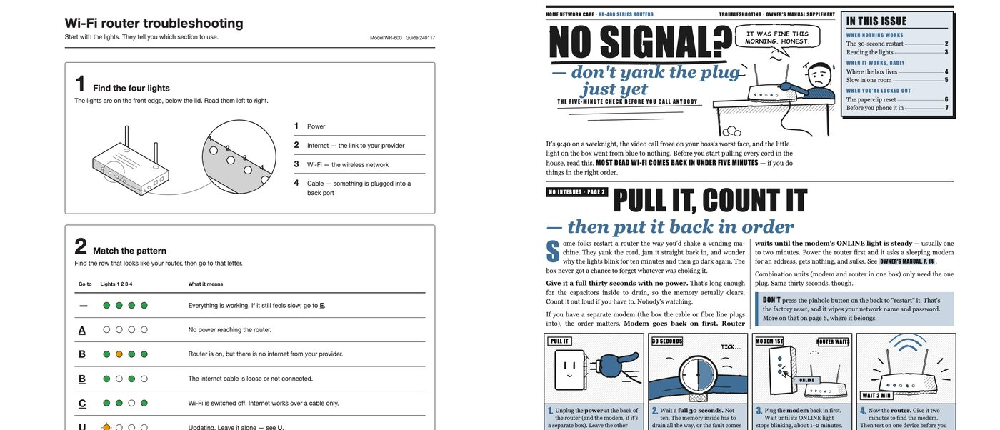
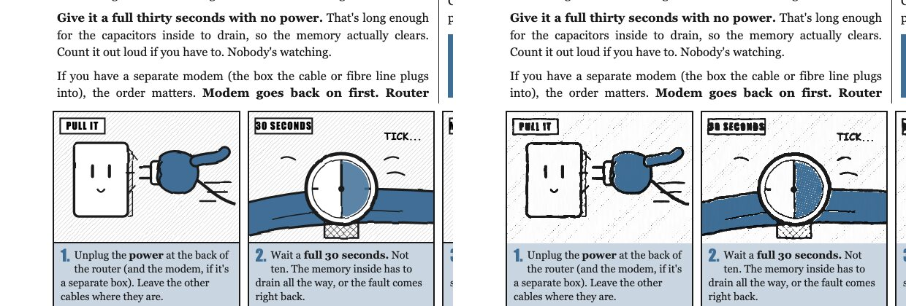
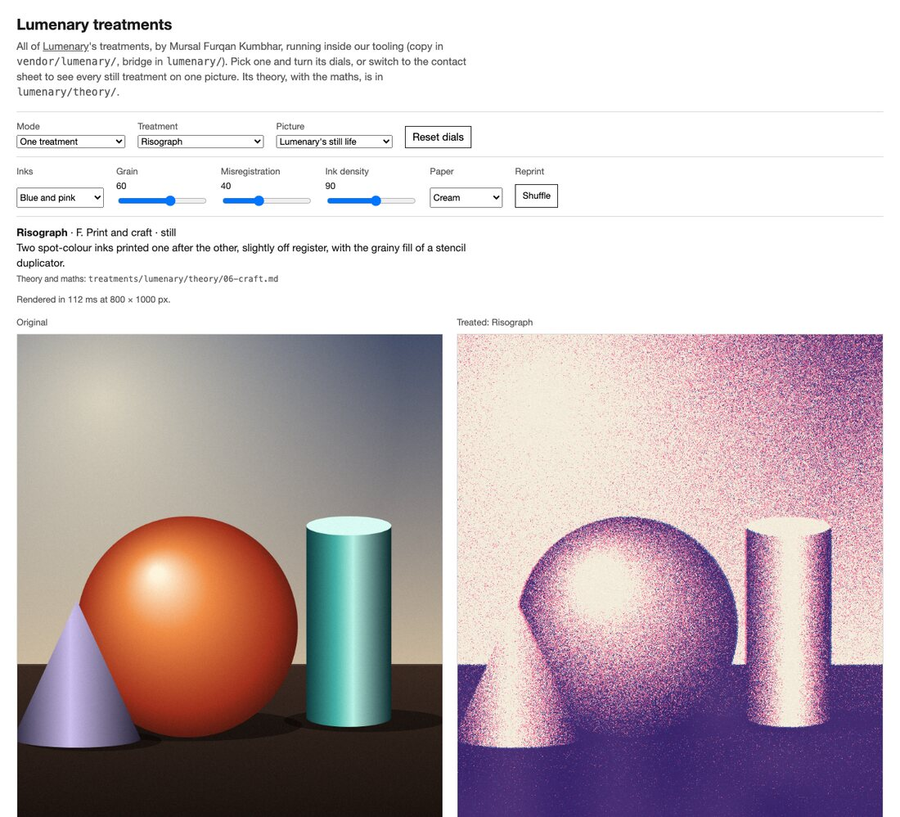
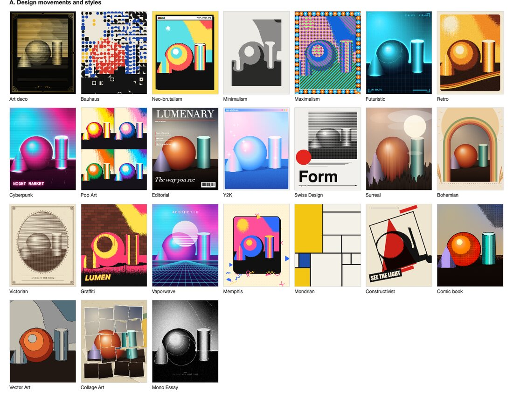
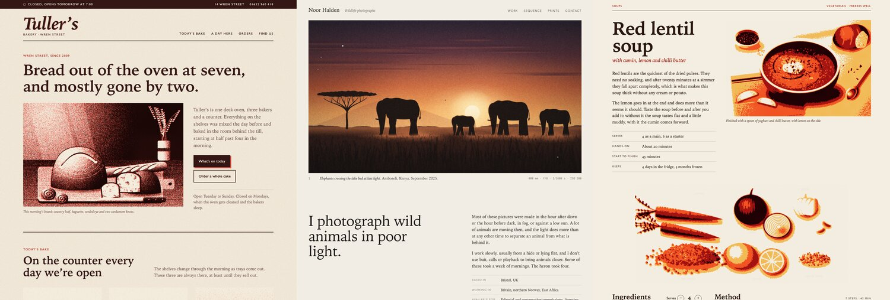

# style

A library of UX and visual design knowledge learned from real human-made work, filed by
the problem it solves, for coding agents to look up when they build something.

AI-built pages drift toward the same defaults. Measured here (C-005): given no style, this
agent put 7 pages on 6 unrelated subjects (a bakery, CLI docs, a wildlife portfolio, an energy
dashboard, a recipe, a repair guide) on the same cream paper (`#f3efe6`–`#f7f1e6`) with
warm near-black text and a terracotta accent near `#c4501f`. This library gives an agent the
reasoning behind how people solved the same problem before: why IKEA manuals have no
words, or why the step number is the biggest thing on the page. It doesn't copy brands
or catalogue looks.



*Two pages agents built for the same brief, a home router's troubleshooting page. Left: with the
IKEA line-art style only (C-008), which beat a page built with no guidance. Right: with the PS
Magazine hand-inked style (C-011), which beat the left one in a blind pick.*

## For an agent using the library

1. Pick two things separately:
   - a **problem entry**: the folder in `library/` that matches what your page has to do
     (`step-by-step-instructions/`, `troubleshooting-by-symptom/`);
   - an **art style** from `library/art-styles/` for how it looks. Three styles so far:
     PS Magazine hand-inked (C-011) beat IKEA line art, which had beaten the default (C-008);
     NASA typographic (C-009) didn't help. Check a style's `tested_in` before relying on it.
2. Read the entry. Follow **section 4 (rules)**, and check **section 5** to see whether
   your case is one where it doesn't apply.
3. If the entry lists a `best_example`, that's a page an agent built from it which won
   a blind test. Use it to see what the rules look like in practice, not as something to copy.
4. For the page's pictures, use a treatment from `treatments/`, either ours or one of
   Lumenary's 214 (see below). Treatments change the pictures, not the page: in C-014, pages
   built with the engine were the ones the judge would rather spend time on, but the page
   around the pictures still needed a style to stop looking AI-made.

## Pictures: treatments and the Lumenary engine

A page is built in two layers (`METHOD.md`). The guides above set structure, layout and voice.
**Treatments** are the top layer: procedures that make a page's drawings and photos look printed
or made by hand, each derived from the process that made the look, with the maths written out.



*Our `press` treatment (two-colour letterpress: ink spread, edge wobble, misregistration, screened
tints) on drawings from the C-011 page. Left: the agent's SVG. Right: printed. It made the page
read as less AI-made, and the judge also said the drawings looked filtered (C-012).*

The top layer also includes **[Lumenary](https://github.com/mursalfk/lumenary)** by **Mursal Furqan
Kumbhar**: 214 browser-only image treatments, each with a theory page giving the equations its code
runs. His engine is the base of patternbook's `engine/`, where patternbook's own styles and process models build on
it, and his theory sits with the rest of patternbook's knowledge in `processes/` (as received in
`processes/sources/lumenary/`), used with his permission (see `vendor/lumenary/NOTICE.md`). The method in `METHOD.md`
step 2c, deriving a look from the process that made it, was learned from his theory pages.



*`treatments/studio.html`: pick any style and turn its dials. This is his
risograph on his test still life.*



*The contact sheet runs every still treatment on one picture. This is section A, design
movements: Art Deco, Bauhaus, Swiss Design, Memphis, Mondrian, Constructivist and the rest.*



*Three pages fresh agents built with the engine and no style file (C-014). The judge would rather
spend time on each of them than on its no-engine version, but only the bakery read as less
AI-made. The pictures changed; the cream background, serif type and small uppercase labels around
them didn't.*

**Try them live** (GitHub Pages, served from `main`):

- [Studio](https://rubix982.github.io/patternbook/treatments/studio.html): every style, with its dials.
- [Contact sheet](https://rubix982.github.io/patternbook/treatments/studio.html?mode=sheet): every still style on one picture.
- [Our print treatments](https://rubix982.github.io/patternbook/treatments/demo.html): `press`, `riso`, `halftone`, `hatch`.
- [All demos](https://rubix982.github.io/patternbook/), including the C-008 and C-011 winning pages.

Or clone the repo and open the same files from disk: `treatments/studio.html`, `treatments/demo.html`.
- On a page: load `engine/engine.js` and `treatments/treatments.js`, then
  `Treatments.treatAll('svg[role=img]', { treatment: 'style:halftone' })`, or
  `{ treatment: 'press' }` for one of ours. More in `treatments/README.md`.

The two subject-aware Lumenary treatments (Type Behind, Split Treatment) load a model, so from disk they
need a local web server (`python3 -m http.server` from the repo root). They haven't been confirmed to
work yet, on the live site or locally. Everything else opens straight from disk.

## Layout

```
library/<problem>/<source>.md   problem entries (template: library/_template.md)
library/art-styles/<style>.md   art styles, used alongside any problem entry
METHOD.md                       how an entry is made and tested
CARD.md                         the open card, and closed ones with results
threads.md                      open questions, not yet worked on
runs/<card>/                    test prompts, generated pages, blind keys
processes/                      all knowledge of how looks are made: process pages (every model in full), primitives,
                                foundations, models; Lumenary as received in processes/sources/lumenary/
engine/                         the engine: styles (picture in, treated picture out; Lumenary's and ours), the process
                                models in core/, the studio API, one bundle (engine.js), checks and demo pages
treatments/                     the picture layer that applies styles to pages, the studio page, and its demos
vendor/lumenary/                what else was kept of Lumenary (Mursal Furqan Kumbhar): its NOTICE, README, scripts
tools/                          measuring and blind-test scripts
docs/images/                    pictures in this README
sources/                        local copies of source documents (git-ignored)
```

## What's been shown so far

- **C-001:** a page built with the IKEA entry beat a page built with no guidance in a
  blind pick, applying 6/6 of its rules.
- **C-002:** it also beat a page built from a reference the agent wrote for itself in
  the same format, on both questions (less AI-made; better to use while working). It
  had 414 words outside drawings, against 1,649 for the self-reference page.
- **C-003:** checked against a chair, a chest of drawers and a lamp, only 6 of the
  entry's 14 BILLY-based facts held everywhere. Most of the rest turned out to be
  *conditional*: IKEA uses a device only when the task has the problem it solves. The
  entry and rules 2, 3, 5 were revised.
- **C-004:** the revised entry against the old one, both fresh pages. Split: revised won
  "less AI-made", old won "which would you use" ("more concise… step by step"). The
  revised page had spread a reader's choice across steps; rule 2 now keeps choices in
  one place (not yet re-tested).
- **C-005:** the unguided default, measured on 7 pages: cream background 7/7, warm
  near-black text 7/7, terracotta accent 7/7, uppercase eyebrow labels 6/7, pill chips
  5/7; Inter, purple and gradients 0–1/7. This is the new default checklist in METHOD.md.
- **C-006:** entry #2, troubleshooting by symptom, from four makers with no shared style
  (Miele, Brother, Toyota, Garmin). Six devices were constant across all four (symptom
  first; cause separate from fix; several causes per symptom; escalation last; long fixes
  linked out; imperative actions).
- **C-007:** entry #2 lost its blind test. The page built with no guidance already
  followed 5–6 of its 6 rules, one step at a time; the entry's page copied the printed
  manuals' exhaustive tables (6× the words) and was harder to use. Lesson now in METHOD.md
  step 2b: check what the agent already does before writing an entry.
- **C-008:** IKEA's visual system on its own, as an art-style file with no structural rules,
  given for the router page. It won both questions against an unguided page of the same
  length (591 vs 609 words). So art style is its own axis, and in this case it was the part
  that read as AI-made.
- **C-009:** a second art style, from NASA's 1976 Graphics Standards Manual, given alone for a
  CLI-docs page. The agent followed it closely, but Saif called both pages AI-made and
  preferred the unguided one to use. So C-008 doesn't generalise to "any human style" yet.
  The palette checklist scored the pages 0/5 vs 5/5 and didn't predict the judgement.
- **C-010:** the judge marked six judged pages for what reads AI-made. No palette trait was
  named. What was named: cold, empty white space (on both human-style pages), a missing
  header, enthusiastic copy, perfect vector drawings, too much text. That's now METHOD.md's
  judge's checklist. The C-008 winner drew the most criticism, so "less AI-made than the
  default" is as far as that result goes.
- **C-011:** a third style, from the US Army's PS Magazine (1953/1961), written to supply what
  the judge said was missing: hand-inked, textured drawing, a real header, a plain voice, dense
  pages. It won both blind questions against the line-art style, the previous best. Cost: harder
  to navigate the technical details.
- **C-012:** our `press` treatment on the C-011 winner's drawings. The treated page won both
  looks questions against the untreated one, but the judge said its drawings looked filtered.
- **C-013:** Lumenary's risograph ink model against `press` on the same page. Equal on "less
  AI-made" and "printed", but the risograph read as the more filtered of the two.
- **C-014:** fresh agents with the Lumenary engine on three C-005 briefs. The judge would rather
  spend time on the engine page in 3 of 3 pairs, but it read as less AI-made in only 1 (1 tie,
  1 loss). The page base stayed on the default around better pictures.

One judge so far, and usually one run per arm. See each card's limits.

## Tools

Need poppler (`pdffonts`, `pdftoppm`) and ImageMagick (`magick`): `brew install poppler imagemagick`.

- `tools/measure-pdf.sh <pdf> [page]` — fonts, page size, top colours.
- `tools/blind.sh <run-dir> <a.html> <b.html>` — random order, key, opens both, prints their links.
- `python3 -I tools/inline-treatment.py <page> <out> --treatment press` — a copy of a page with a
  treatment applied to its drawings.
- `node engine/build.mjs` — rebuild the engine bundle; `node engine/catalog.mjs` — regenerate its style catalogue.
- `python3 -I tools/words.py <pages>` — words outside drawings.
- `python3 -I tools/css-profile.py <pages>` — background, text, accent hues, fonts, radii, shadows, gradients.

## Related

[`graphics-reuse`](https://github.com/Rubix982/graphics-reuse) (a sibling repository) uses this library's method for reuse techniques in graphics, with a measurement against a fresh full computation in place of the blind pick.
